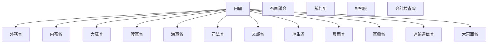

# 国の行政機関の組織図（Mermaid）

時点: 戦時行政機構再編（昭和18年11月1日頃 / 1943-11-01）

出典粒度: 国会図書館再編年表（府省級・概観）

## 全体概要

## 備考

- 農林・商工・逓信・鉄道などを再編し農商・軍需・運輸通信へ
- 拓務省は大東亜省設置に伴い廃止済み（昭和17年）
- 戦時の短命再編が多いため、このコミットは骨格のみ

## 出典

- https://dl.ndl.go.jp/pid/8243529
