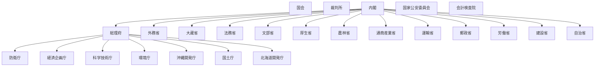

# 国の行政機関の組織図（Mermaid）

時点: 国土庁設置後（昭和49年6月26日 / 1974-06-26）

出典粒度: 国会図書館再編年表（府省級）— 大臣庁拡充期の代表時点

## 全体概要

## 備考

- 昭和35年自治省、昭和46年環境庁、昭和47年沖縄開発庁、昭和49年国土庁
- いわゆる1府12省＋大臣庁が並ぶ時期

## 出典

- https://dl.ndl.go.jp/pid/8243529
