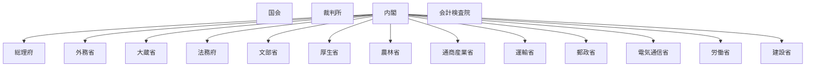

# 国の行政機関の組織図（Mermaid）

時点: 国家行政組織法施行前後の再編（昭和24年 / 1949-06-01）

出典粒度: 国会図書館再編年表（府省級）

## 全体概要

## 備考

- 内務省は昭和22年に廃止済み
- 商工省→通商産業省、逓信省→郵政・電気通信
- 労働省・建設省が設置済み

## 出典

- 国家行政組織法（昭和23年法律第120号）関連再編
- https://dl.ndl.go.jp/pid/8243529
