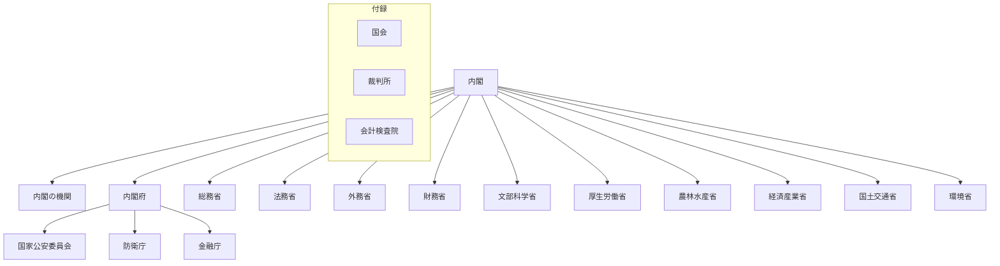

# 国の行政機関の組織図（Mermaid）

時点: 中央省庁再編（平成13年1月6日 / 2001-01-06）

平成以降は府省ごとにディレクトリを分け、**外局・主要な特別の機関**まで記載。

## 全体概要

## 行政機構

- [内閣の機関](行政機構/内閣の機関/README.md)
- [内閣府](行政機構/内閣府/README.md)
- [総務省](行政機構/総務省/README.md)
- [法務省](行政機構/法務省/README.md)
- [外務省](行政機構/外務省/README.md)
- [財務省](行政機構/財務省/README.md)
- [文部科学省](行政機構/文部科学省/README.md)
- [厚生労働省](行政機構/厚生労働省/README.md)
- [農林水産省](行政機構/農林水産省/README.md)
- [経済産業省](行政機構/経済産業省/README.md)
- [国土交通省](行政機構/国土交通省/README.md)
- [環境省](行政機構/環境省/README.md)

## 付録

- [国会](付録/国会/README.md)
- [裁判所](付録/裁判所/README.md)
- [会計検査院](付録/会計検査院/README.md)

## 出典

- https://ja.wikipedia.org/wiki/中央省庁再編
- https://ja.wikipedia.org/wiki/外局
- 中央省庁等改革関連法・各府省設置法
