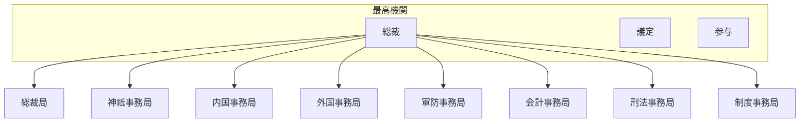

# 国の行政機関の組織図（Mermaid）

時点: 三職八局制（慶応4年2月3日 / 1868-02-25）

出典粒度: JACAR 組織変遷表・年表（府省／使／院／庁級）

## 全体概要

## 備考

- 七科を八局に改め、総裁局を新設

## 出典

- [JACAR 組織変遷表：職員令](https://www.jacar.go.jp/exhibition/glossary/meijiasia/table/transition1.html)
- [JACAR 組織変遷表：廃藩置県～太政官制廃止](https://www.jacar.go.jp/exhibition/glossary/meijiasia/table/transition2.html)
- [JACAR 組織変遷表：内閣制発足](https://www.jacar.go.jp/exhibition/glossary/meijiasia/table/transition3.html)
- [JACAR 組織変遷表：台湾領有以降](https://www.jacar.go.jp/exhibition/glossary/meijiasia/table/transition4.html)
- [JACAR 年表：内政・外政・工業](https://www.jacar.go.jp/exhibition/glossary/meijiasia/table/history1.html)

