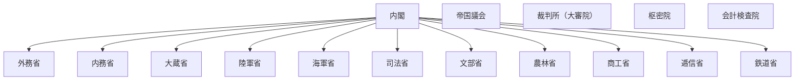

# 国の行政機関の組織図（Mermaid）

時点: 農商務省分割・農林省／商工省設置（大正14年4月1日 / 1925-04-01）

出典粒度: 国会図書館「中央省庁再編の制度と運用」再編年表（府省級）

## 全体概要

## 備考

- 農商務省を農林省・商工省に分割
- 鉄道省は大正9年設置済み

## 出典

- https://dl.ndl.go.jp/pid/8243529 （中央省庁再編の制度と運用）
